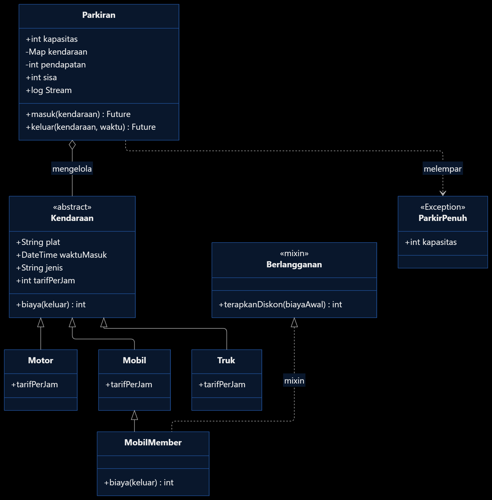
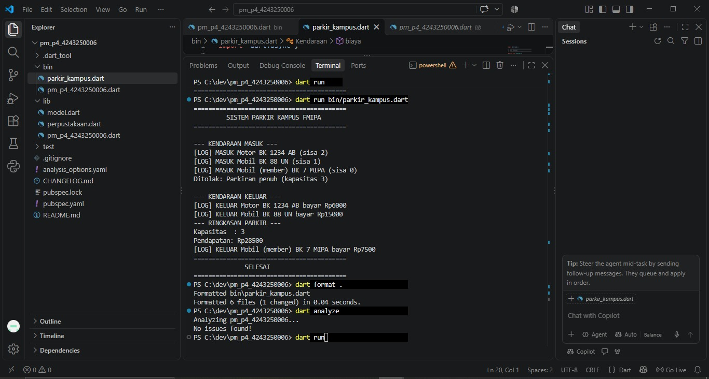

# Tugas Rutin 4 — Sistem Parkir Kampus FMIPA

## Identitas Mahasiswa

**Nama:** Benedict Sandi Pangestu Rosa  
**NIM:** 4243250006  
**Kelas:** PSIK 24 D  
**Program Studi:** S1 Ilmu Komputer  
**Fakultas:** FMIPA  
**Universitas:** Universitas Negeri Medan  
**Mata Kuliah:** Pemrograman Mobile  
**Dosen Pengampu:** Adidtya Perdana, S.T., M.Kom.

## Deskripsi Program

Sistem Parkir Kampus FMIPA merupakan aplikasi console berbasis bahasa Dart yang mensimulasikan proses kendaraan masuk dan keluar dari area parkir kampus. Aplikasi ini menerapkan konsep Object-Oriented Programming (OOP) dan asynchronous programming.

Sistem mendukung beberapa jenis kendaraan, membatasi kapasitas parkir, menghitung tarif sesuai durasi, memberikan diskon bagi kendaraan member, serta mengirimkan aktivitas parkir melalui Stream.

## Fitur Program

1. Mengelola kendaraan Motor, Mobil, Truk, dan Mobil Member.
2. Menghitung tarif parkir berdasarkan jenis kendaraan dan durasi.
3. Membulatkan durasi parkir ke atas dengan minimum pembayaran satu jam.
4. Memberikan diskon 50% bagi kendaraan member.
5. Memvalidasi kapasitas parkiran dan menolak kendaraan ketika penuh.
6. Mensimulasikan palang otomatis menggunakan `Future.delayed()`.
7. Menampilkan aktivitas kendaraan masuk dan keluar melalui Stream.
8. Menghitung total pendapatan parkiran.

## Teknologi dan Konsep

- Bahasa Pemrograman: Dart
- Editor: Visual Studio Code
- Jenis Aplikasi: Console Application
- OOP: Abstract Class, Constructor, Encapsulation, Inheritance, Polymorphism, Mixin
- Async Programming: Future, async/await, StreamController.broadcast()
- Error Handling: Custom Exception

## Diagram Kelas

Diagram kelas menggambarkan hubungan `Kendaraan` dengan `Motor`, `Mobil`, dan `Truk`. `MobilMember` merupakan turunan `Mobil` yang menggunakan mixin `Berlangganan`. Class `Parkiran` mengelola kendaraan dan menggunakan exception `ParkirPenuh` ketika kapasitas tercapai.



## Cara Menjalankan

Pastikan Dart SDK sudah terpasang. Buka terminal pada direktori proyek, kemudian jalankan:

```bash
dart run bin/parkir_kampus.dart
```

Untuk merapikan dan memeriksa kode:

```bash
dart format .
dart analyze
```

## Dokumentasi Pengujian

### Skenario Pengujian

Program diuji dengan kapasitas parkiran sebanyak tiga kendaraan. Tiga kendaraan pertama berhasil masuk, sedangkan kendaraan keempat ditolak karena parkiran telah penuh.

Hasil perhitungan biaya:

| Kendaraan | Durasi Ditagih | Tarif per Jam | Diskon | Biaya |
|---|---|---|---|---|
| Motor BK 1234 AB | 2 jam | Rp3.000 | - | Rp6.000 |
| Mobil BK 88 UN | 3 jam | Rp5.000 | - | Rp15.000 |
| Mobil Member BK 7 MIPA | 3 jam | Rp5.000 | 50% | Rp7.500 |

**Total pendapatan: Rp28.500**



## Penjelasan Penerapan Enkapsulasi, Polimorfisme, dan Async

Dalam pembuatan Sistem Parkir Kampus, saya menerapkan enkapsulasi pada class `Parkiran` melalui atribut `_kendaraan` dan `_pendapatan`. Kedua atribut tersebut dibuat privat agar data kendaraan dan pendapatan tidak dapat diubah secara langsung dari library lain. Informasi yang diperlukan tetap dapat diakses melalui getter `sisa` dan `pendapatan`.

Konsep polimorfisme diterapkan menggunakan abstract class `Kendaraan` yang diwarisi oleh `Motor`, `Mobil`, dan `Truk`. Setiap subclass mempunyai tarif parkir berbeda, tetapi dapat disimpan dalam satu `List<Kendaraan>`. Selain itu, class `MobilMember` menggunakan mixin `Berlangganan` untuk menerapkan diskon 50% melalui method `biaya()`.

Penerapan asynchronous programming terdapat pada method `masuk()` dan `keluar()` yang menggunakan `Future.delayed()` untuk mensimulasikan proses palang otomatis. Kedua method tersebut dipanggil dengan `await` pada fungsi `main()`. Saya juga menggunakan `StreamController.broadcast()` untuk mengirimkan informasi aktivitas kendaraan yang kemudian ditampilkan oleh listener. Melalui implementasi ini, saya dapat memahami bagaimana OOP membantu mengatur struktur program, sedangkan async digunakan untuk menangani proses yang membutuhkan waktu.

## Pernyataan Penggunaan AI

Dalam pengerjaan tugas ini, saya menggunakan ChatGPT sebagai alat bantu memahami konsep OOP dan asynchronous programming, membantu penyusunan serta peninjauan kode, dan menyiapkan dokumentasi. Program dijalankan dan diuji melalui Visual Studio Code. Saya bertanggung jawab atas pemahaman, pemeriksaan, dan hasil pekerjaan yang dikumpulkan.

## Referensi

Adidtya Perdana, S.T., M.Kom. (2026). *Modul Ajar Pemrograman Mobile Pertemuan 4: Object-Oriented Programming dan Async Programming di Dart*. Universitas Negeri Medan.

Dart Documentation: https://dart.dev/